<h3><code>arsalaan@github ~ $ whoami</code></h3>

  

<h3><code>arsalaan@github ~ $ ./portfolio.sh --live</code></h3>

<table>
<tr>
<td valign="top"></td>
<td valign="top"></td>
</tr>
</table>

### 🔴 Live Portfolio — dekhna hai to yahin se kholo

**[arsalaan-ahmed-portfolio.vercel.app](https://arsalaan-ahmed-portfolio.vercel.app/)**

20+ live projects, 10+ tools &amp; technologies, 6+ industries — agency sites, cafés, e-commerce aur cinematic portfolios. GitHub profile pe portfolio sirf link nahi hai, ye uska live showcase hai.

 

<h3><code>arsalaan@github ~ $ ./contributions.sh</code></h3>

Ye graph GitHub Actions se roz refresh hota hai — koi third-party stats service nahi, sirf apna SVG.

---

## Featured Projects

### Quietude — A Cinematic Nature Experience
Peaceful, scroll-driven 8-chapter journey through forests, water, oceans aur night sky. Procedural ambient audio Web Audio API se, koi audio file nahi.
- **Stack:** Next.js 16, TypeScript, Tailwind CSS 4, Framer Motion, Lenis
- **Code:** [`arsalaannahmed/quietude`](https://github.com/arsalaannahmed/quietude) — app `quietude/quietude-build/` folder me hai, andar poora README bhi hai

### MediCare1
React + Vite + Tailwind app, `medilink/` folder me.
- **Stack:** React 19, Vite 7, TypeScript, Tailwind CSS 4
- **Run:** `cd medilink && npm install && npm run dev`
- **Code:** [`arsalaannahmed/MediCare1`](https://github.com/arsalaannahmed/MediCare1)

## Skills
React · Next.js · TypeScript · JavaScript · Tailwind CSS · Supabase · Framer Motion · GSAP · Git &amp; GitHub · AI-powered workflows

## Contact
- 🌐 Portfolio: https://arsalaan-ahmed-portfolio.vercel.app/
- ✉️ Email: arsalaanahmedwork@gmail.com
- 💻 GitHub: https://github.com/arsalaannahmed

---
Profile art pattern: terminal-style animated SVG, inspired by Avi Vashishta's animated README guide — ASCII-style banner, neofetch info card, aur live contribution heatmap, sab self-contained SVG me.
